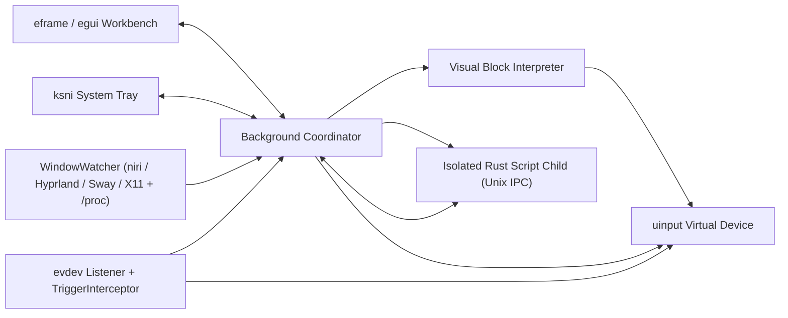

# ClickForge Architecture

ClickForge is organized as a Cargo workspace with two crates: `crates/clickforge_sdk` (the shared script contract and Unix IPC client) and the root `clickforge` package (models, storage, Linux platform services, script engine, system tray, and native `eframe`/`egui` workbench).

## Workspace Layout

```text
clickforge/
├── Cargo.toml                         # Workspace root, Rust 2024, overflow-checks = true in release
├── crates/clickforge_sdk/src/
│   ├── lib.rs                         # ScriptError, ScriptResult, execute_script_entrypoint
│   ├── input_types.rs                 # MouseButton (5), KeyCode (103), InputTrigger, GaussianRangeMs
│   ├── ipc_protocol.rs                # IpcRequest (13), IpcResponse (3), bounded JSON framing
│   └── context.rs                     # ScriptContext Unix IPC client and 2 ms interruptible waits
├── src/
│   ├── lib.rs                         # Library module root for integration tests
│   ├── main.rs                        # Tracing, SIGINT/SIGTERM bridge, runtime bootstrap, eframe host
│   ├── models/
│   │   ├── blocks.rs                  # BlockId, TriggerBlock (4), ConditionExpr (6), StatementKind (20)
│   │   ├── block_tree.rs              # Recursive AST lookup, cycle-checked move, key collection
│   │   ├── target.rs                  # ActiveWindowSnapshot, RunningProcessEntry, GameTargetRule, TargetScope
│   │   ├── script.rs                  # ScriptDocument, ScriptMode, Building Upgrade template
│   │   ├── validation.rs              # Mandatory Hard Kill-Switch and parameter safety gate
│   │   └── runtime_contracts.rs       # InputSink, PhysicalInputReader, TriggerInterceptControl, snapshots
│   ├── storage/
│   │   ├── mod.rs                     # StorageError, atomic write-sync-rename, bounded JSON read
│   │   ├── script_repository.rs       # Script CRUD, validation gate, 10-backup rotation
│   │   └── settings_store.rs          # Clamped AppSettings persistence
│   ├── linux/
│   │   ├── mod.rs                     # VIRTUAL_DEVICE_NAME, create_linux_runtime
│   │   ├── process_scanner.rs         # Bounded /proc reader, .exe extraction, SteamAppId inheritance
│   │   ├── niri_ipc.rs                # $NIRI_SOCKET request and EventStream client
│   │   ├── window_watcher.rs          # Compositor abstraction (niri, Hyprland, Sway, X11 xprop)
│   │   ├── evdev_keymap.rs            # Bidirectional KeyCode/MouseButton <-> evdev mapping
│   │   ├── uinput_injector.rs         # Persistent /dev/uinput device, pressed-set tracking, NoopInputSink
│   │   ├── trigger_interceptor.rs     # RAII EVIOCGRAB coordinator and grabbed-event classifier
│   │   └── evdev_listener.rs          # Non-blocking /dev/input/event* loop and pointer forwarding
│   ├── engine/
│   │   ├── timing.rs                  # wait_interruptible_ms, uniform/Gaussian samplers, histogram helper
│   │   ├── block_interpreter.rs       # Zero-compile AST interpreter with RAII input release
│   │   ├── rust_codegen.rs            # VisualProgram -> clickforge_sdk Rust source translator
│   │   ├── rust_compiler.rs           # Pre-warmed Cargo cache builder and JSON diagnostic line mapper
│   │   ├── rust_script_runner.rs      # Unix domain socket IPC server and IsolatedChildGuard (SIGKILL)
│   │   ├── worker_supervisor.rs       # Worker lifecycle, binary hash cache, tray summary derivation
│   │   ├── coordinator_telemetry.rs   # Bounded telemetry logs (500) and delay history (128)
│   │   ├── coordinator_loop.rs        # Multi-script focus switcher, kill-switch monitor, intercept routing
│   │   └── coordinator.rs             # CoordinatorHandle and bounded command queue
│   ├── tray/
│   │   └── system_tray.rs             # ksni StatusNotifierItem service and 24x24 ARGB32 phase icons
│   └── ui/
│       ├── theme.rs                   # Forge Slate palette tokens, Fira Sans/monospace loader, key map
│       ├── app.rs                     # eframe::App lifecycle, tray hide/show, key capture, repaint pacing
│       ├── app_actions.rs             # Command dispatch for CRUD, validation gates, Export to Rust
│       ├── sidebar.rs                 # Grouped script navigation and New Script modal
│       ├── script_settings_bar.rs     # Target pill, mode toggle, Kill-Switch binder, STOP ALL
│       ├── target_picker_modal.rs     # 2-tab Cheat Engine style window/process attachment modal
│       ├── block_palette.rs           # 5-category draggable block palette
│       ├── block_canvas.rs            # Trigger hat, dot grid, magnetic drop indicator, drag ghost
│       ├── block_node_renderer.rs     # Notched puzzle blocks, C-block spines, active block highlight
│       ├── block_field_editors.rs     # Inline editors for all 20 StatementKind variants and conditions
│       ├── rust_editor_panel.rs       # Syntax-highlighted Rust editor, snippets, compiler diagnostics
│       └── telemetry_drawer.rs        # Subsystem badges, cached Gaussian histogram, log viewer
├── scripts/
│   ├── install_udev_rules.sh          # Optional udev rule and input group installer
│   ├── build_release.sh               # Release binary build script
│   └── verify_all.sh                  # Automated audit, fmt, clippy, test, and release gate
└── tests/                             # End-to-end integration test suites
```

## Runtime Data Flow



### Thread Topology

1. **UI Main Thread (`eframe`):** Renders the Forge Slate interface, polls immutable `CoordinatorSnapshot` copies, handles minimize-to-tray `ViewportCommand` transitions, and paces repaints (`50 ms` while running/compiling/dragging, `250 ms` while idle or hidden).
2. **Signal Bridge Thread (`clickforge-signal-bridge`):** Watches an async-signal-safe `AtomicBool` tripped by `SIGINT`/`SIGTERM`, propagates shutdown to `shutdown_flag`, and wakes `egui::Context` for clean exit.
3. **Window Watcher Thread (`clickforge-window-watcher`):** Subscribes to `$NIRI_SOCKET` `"EventStream"` on `niri` (with Hyprland, Sway, and X11 polling fallbacks), refreshes `/proc` every `2_000 ms`, and pushes focus changes over a bounded `sync_channel(64)`.
4. **Physical Input Thread (`clickforge-evdev-listener`):** Reads non-blocking `/dev/input/event*` devices (`MAX_MONITORED_INPUT_DEVICES = 32`), updates lock-free `SharedPhysicalInputState`, emits key/button transitions over a bounded `sync_channel(256)`, and manages `EVIOCGRAB` forwarding frames.
5. **Coordinator Thread:** Runs on a `10 ms` tick draining bounded UI commands (`128`), input events, focus events, and worker telemetry (`512`). Reconciles enabled scripts against focus rules, arm toggles, and emergency-stop state.
6. **Per-Script Worker Threads:** Each active script runs either `execute_visual_program` directly or `run_compiled_rust_script` hosting a child process over a dedicated Unix socket.
7. **System Tray Thread (`ksni`):** Serves D-Bus `StatusNotifierItem` updates and forwards menu clicks over a bounded `sync_channel(32)`.

## Safety Invariants

### 1. Mandatory Hard Kill-Switch Enforcement

`validate_script_for_persistence_and_execution` is enforced at five layers:

- **Validation layer (`src/models/validation.rs`):** Rejects `kill_switch_key == None` and rejects collisions with the trigger key, arm-toggle key, emitted keys (`KeyTap`, `KeyDown`, `KeyUp`, `TypeText`), and `IsInputPressed` condition keys.
- **Persistence layer (`src/storage/script_repository.rs`):** `ScriptRepository::save_script` rejects invalid scripts before touching disk.
- **Compiler layer (`src/engine/rust_compiler.rs`):** `compile_rust_script` validates before preparing Cargo files or invoking `cargo`.
- **Coordinator layer (`src/engine/coordinator_loop.rs`):** Both `SetScriptEnabled` and `reconcile_single_script` refuse to arm or run invalid scripts.
- **Desktop UI (`src/ui/script_settings_bar.rs`, `sidebar.rs`, `rust_editor_panel.rs`, `app_actions.rs`):** Save, Enable, and Compile & Check controls stay disabled with inline safety-gate banners until validation passes.

### 2. Zero Self-Trigger Feedback Loop

`UinputInjector` registers a single virtual device named `"ClickForge Virtual Input"` (`VIRTUAL_DEVICE_NAME`). When `evdev_listener` discovers or hotplugs `/dev/input/event*` devices, `is_virtual_clickforge_device` filters out any device whose name contains `VIRTUAL_DEVICE_NAME` (case-insensitively), preventing emitted events from feeding back into `SharedPhysicalInputState` or re-triggering scripts.

### 3. Safe `EVIOCGRAB` Pointer Interception

`TriggerInterceptor` and `evdev_listener` enforce six guardrails on mouse button interception:

- Grabbing is refused when `/dev/uinput` is offline (`NoopInputSink` fallback active).
- Keyboard triggers never acquire `EVIOCGRAB`; only physical pointer devices with `REL_X`, `REL_Y`, and `BTN_LEFT` can be grabbed.
- Acquisition waits until the physical trigger button is released so focus-click releases reach the compositor.
- While grabbed, `classify_grabbed_pointer_event` forwards every `EV_REL` motion/wheel event and non-trigger button in synchronized `SYN_REPORT` frames through `UinputInjector::forward_raw_events`, suppressing only the designated trigger button while still updating `SharedPhysicalInputState`.
- Any forwarding error immediately runs `release_all_grabs()` and deactivates interception.
- Focus loss, Kill-Switch press, script disable, `MonitoredDevicePool::drop`, `TriggerInterceptor::drop`, and `SIGINT`/`SIGTERM` all ungrab devices and release tracked virtual keys/buttons.

### 4. Isolated Advanced Rust Execution and Instant `SIGKILL`

User Rust scripts compile inside `~/.local/share/clickforge/script_build_cache/project` with a wrapper `main()` that calls `clickforge_sdk::execute_script_entrypoint(user_script::run_script)`. Compiler JSON diagnostics from `cargo build --message-format=json` subtract the 8-line wrapper header offset so error line numbers map back to the user's editor lines.

At runtime, `run_compiled_rust_script` binds a unique Unix domain socket in `/tmp`, passes its path via `CLICKFORGE_IPC_SOCKET`, and spawns the compiled binary with piped `stderr`. The host reads newline-delimited JSON frames (`MAX_IPC_LINE_BYTES = 65_536`) with a `5 ms` read timeout so abort checks run continuously even if the child stalls. On abort, focus loss, Kill-Switch press, or `IsolatedChildGuard::drop`, the supervisor calls `Child::kill()` (`SIGKILL`), reaps the child with `Child::wait()`, unlinks the Unix socket, and calls `InputSink::release_all_pressed()`.

### 5. Bounded Memory and Overflow Safety

- `[profile.release]` enables `overflow-checks = true`.
- Arithmetic on counters, capacities, and offsets uses `saturating_*` and `checked_*`.
- All cross-thread channels are bounded `std::sync::mpsc::sync_channel` queues.
- Telemetry logs cap at `MAX_TELEMETRY_ENTRIES = 500`, delay history caps at `MAX_DELAY_HISTORY_SAMPLES = 128`, `/proc` scans cap at `MAX_PROCESS_SCAN_ENTRIES = 4096`, script variables cap at `MAX_SCRIPT_VARIABLES = 64`, backups cap at `MAX_SCRIPT_BACKUPS = 10`, and IPC frames cap at `MAX_IPC_LINE_BYTES = 65_536`.
- Visual loops enforce `MIN_LOOP_YIELD_MICROS = 250` to prevent zero-delay CPU spin locks, and interruptible waits poll every `INTERRUPT_POLL_SLICE_MS = 2`.
